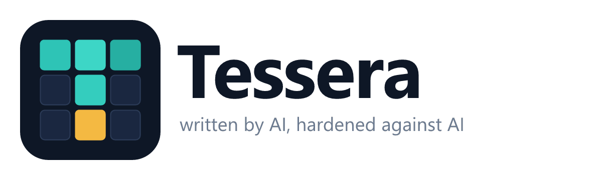

<p align="center">
  <picture>
    <source media="(prefers-color-scheme: dark)" srcset="docs/brand/tessera-logo-dark.png">
    
  </picture>
</p>

*[English](README.md) · Italiano*

[](https://doi.org/10.5281/zenodo.23855820)

**Un linguaggio di programmazione scritto dalle IA e blindato contro le IA.**
Effetti dichiarati, contratti verificati, vulnerabilità che non compilano.

> *A programming language written by AI, hardened against AI.*

Creato da **Stefano Stegani - Airgrid Network - [www.airgrid.it](https://www.airgrid.it)**.

Le IA scrivono sempre più codice, e le stesse capacità servono a trovarne le falle su scala enorme. Tessera sposta la sicurezza dal programmatore al compilatore: ciò che un'IA può sbagliare o sfruttare deve diventare un errore di compilazione.

```
fn parse_price(text: Str) -> Result[Cents, ParseError]
  effects: none
  requires: text.len() > 0
  ensures: result is Ok(c) implies c >= Cents(0)
  example: parse_price("12.50") == Ok(Cents(1250))
  example: parse_price("abc") == Err(ParseError.NotANumber)
do
  -- ...
end fn parse_price
```

Chi usa `parse_price` sa dalla firma cosa riceve, cosa può fallire, quali condizioni valgono e che la funzione non tocca rete, file o stato.

**Con un occhio di riguardo per le IA locali.** Tessera funziona anche con i grandi modelli, ma è pensato soprattutto per quelli piccoli che girano sul tuo computer (con Ollama o LM Studio): sono loro a guadagnare di più da un linguaggio in cui il compilatore ferma gli errori. In programma: generazione vincolata dalla grammatica e dati di addestramento verificati dal compilatore.

## Stato

**Prototipo 0.2.** Esistono un interprete completo per il nucleo del linguaggio, i controlli statici e un compilatore verso WebAssembly per le funzioni numeriche pure. È scritto in Python per arrivare in fretta all'esperimento della fase 1; il compilatore definitivo verrà riscritto quando il linguaggio sarà stabile.

| Fase | Cosa | Stato |
|---|---|---|
| 0 | Paper e sintassi | fatto |
| 1 | Interprete, controlli statici, primo compilatore WebAssembly | fatto (0.1, suggerimenti di sintassi in 0.2) |
| 1 | Esperimento: Tessera contro Python con un modello linguistico | pronto; prime corse locali in corso ([experiment/](experiment/)) |
| 2 | Nucleo: tipi statici, compilatore WebAssembly completo, capability di rete | da fare |
| 3 | Addestramento di IA: tensori, derivazione, provenienza dei dati | da fare |
| 4 | Verifica e domini: compilatore verificato, database, web, kernel | da fare |

Stato completo, decisioni prese e prossimi passi: **[STATUS.it.md](STATUS.it.md)**. Direzione: Tessera pensato soprattutto per i modelli di IA locali (sezione 11 del paper).

## Provare

Per imparare il linguaggio c'è il **[manuale](docs/manual.it.md)** (anche in [PDF](docs/manual.it.pdf)).

```bash
python -m venv .venv
.venv/Scripts/pip install -r requirements.txt
```

Su Linux e macOS il percorso è `.venv/bin/pip`. Poi, con l'ambiente attivo:

```bash
python -m tessera esegui examples/checkout.tsr
```

| Comando | Cosa fa |
|---|---|
| `python -m tessera esegui file.tsr` | controlla il programma ed esegue il `process` o `fn main()` |
| `python -m tessera verifica file.tsr` | controlli statici senza eseguire (`--json` per errori leggibili da un modello) |
| `python -m tessera prova file.tsr` | esegue le clausole `example` come test |
| `python -m tessera compila file.tsr -o build` | produce `.wat` e `.wasm` |
| `python -m tessera chiama file.tsr funzione arg... [--wasm]` | chiama una funzione, interpretata o compilata |
| `python -m pytest tests` | 99 test, compresa la prova differenziale interprete contro WebAssembly |

Cosa controlla già il prototipo: effetti dichiarati, contratti, tipi ai confini delle funzioni, `edit` e `take`, overflow, divisione per zero, permessi sui file del `process`, `Secret` mai stampati, `Result` mai ignorati, `match` esaustivi, requisiti di piattaforma. Le regole sono in [spec/semantics.md](spec/semantics.md).

## Contenuto

| Percorso | Cosa contiene |
|---|---|
| [docs/paper.md](docs/paper.md) | Il paper: motivazioni, architettura, modello di sicurezza, valutazione |
| [docs/manual.it.md](docs/manual.it.md) | Manuale per scrivere Tessera a mano ([PDF](docs/manual.it.pdf); in inglese: [manual.md](docs/manual.md), [PDF](docs/manual.pdf)) |
| [spec/syntax.md](spec/syntax.md) | Le decisioni di sintassi, con motivazioni e misure in token |
| [spec/semantics.md](spec/semantics.md) | Le regole di esecuzione decise con il prototipo |
| [spec/tessera.lark](spec/tessera.lark) | La grammatica formale (LALR(1)) |
| [tessera/](tessera/) | Il prototipo: analizzatore, interprete, controlli statici, compilatore WebAssembly, sentinella |
| [examples/](examples/) | Programmi `.tsr`. Eseguibili: `hello`, `checkout`, `prices`, `warehouse`, `permissions`, `numbers`. Illustrativi (usano moduli non ancora scritti): `server`, `training`, `interop` |
| [experiment/](experiment/) | Esperimento della fase 1: 20 esercizi con test nascosti sui casi limite, scritti dallo stesso modello in Tessera e in Python; gira con modelli locali (Ollama, LM Studio), i modelli commerciali sono facoltativi |
| [training/](training/) | Addestramento dei modelli piccoli su Tessera: esercizi e soluzioni verificati dal compilatore, addestramento QLoRA, esportazione in Ollama |
| [tests/](tests/) | Test del prototipo |
| [tools/check_grammar.py](tools/check_grammar.py) | Verifica la grammatica sugli esempi e su 14 errori tipici che deve rifiutare |

## Autore e citazione

Tessera è un'idea originale di **Stefano Stegani - Airgrid Network - [www.airgrid.it](https://www.airgrid.it)**, che ne ha scritto il progetto, la grammatica e il paper. Il codice e i testi si possono riusare, anche in progetti commerciali, alle condizioni della licenza: **chi redistribuisce Tessera o un'opera derivata deve conservare il file [NOTICE](NOTICE), che attribuisce l'opera all'autore**, e non può presentarla come propria.

Per citare il progetto:

> Stefano Stegani - Airgrid Network - www.airgrid.it, *Tessera: written by AI, hardened against AI* (Tessera: scritto dalle IA, blindato contro le IA), 2026. DOI: [10.5281/zenodo.23855820](https://doi.org/10.5281/zenodo.23855820)

Il DOI punta sempre all'ultima versione. Ogni versione ha anche un DOI proprio, archiviato su Zenodo: 0.2.0 [10.5281/zenodo.23881717](https://doi.org/10.5281/zenodo.23881717), 0.1.0 [10.5281/zenodo.23855821](https://doi.org/10.5281/zenodo.23855821).

Il file [CITATION.cff](CITATION.cff) contiene gli stessi dati in forma leggibile dalle macchine: GitHub lo usa per il pulsante "Cite this repository".

## Licenza

[Apache 2.0](LICENSE), con l'avviso di attribuzione in [NOTICE](NOTICE).
