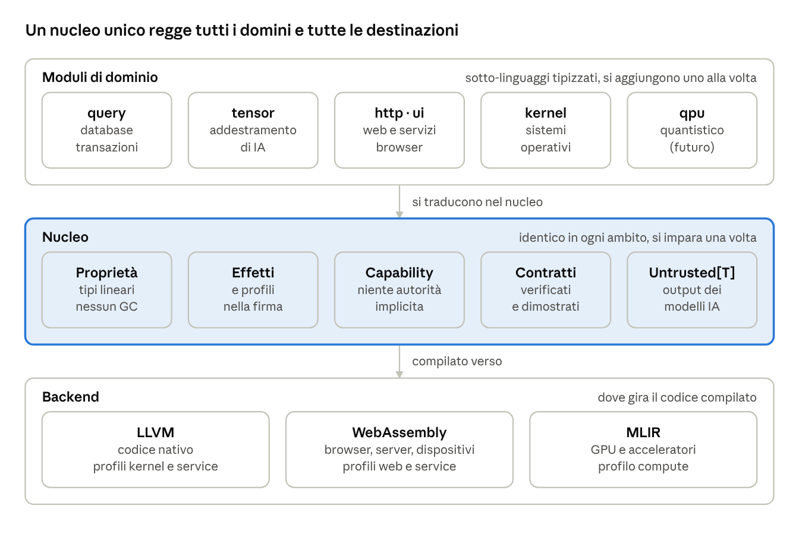
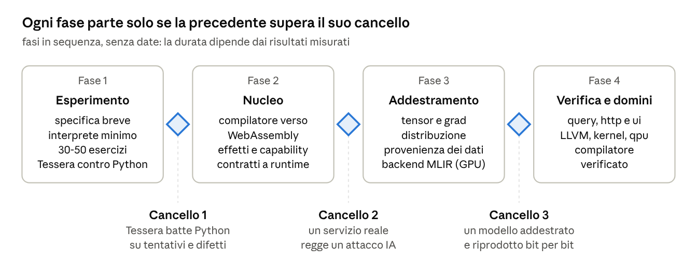

# Tessera: scritto dalle IA, blindato contro le IA

Stefano Stegani · 1 novembre 2026

© 2026 Stefano Stegani. Distribuito con licenza Apache 2.0: si può riusare citando l'autore (vedi il file NOTICE).

## Abstract

Tessera è un linguaggio di programmazione pensato per essere scritto soprattutto da intelligenze artificiali e per resistere ad attaccanti che sono, a loro volta, intelligenze artificiali. Le IA scrivono già gran parte del codice nuovo, e le stesse capacità permettono di cercare vulnerabilità su scala enorme a costo quasi nullo. I linguaggi attuali sono stati progettati per persone e lasciano al programmatore la responsabilità di evitare intere classi di errori.

Tessera sposta questa responsabilità sul compilatore. Le scelte principali sono quattro:

- un **nucleo piccolo e uniforme**, esteso da moduli di dominio (database, web, sistemi operativi, addestramento di IA di nuova generazione, calcolo quantistico);
- un **sistema di effetti e profili**, che dichiara e limita ciò che ogni parte del codice può fare;
- **risorse trattate come permessi unici e non copiabili**, compresa un'identità di rete IPv6 per ogni processo;
- **contratti verificati formalmente**, che rendono dimostrabili le proprietà critiche.

Il paper descrive i principi, l'architettura e il modello di sicurezza, e propone un esperimento per misurare se un modello linguistico scrive codice Tessera corretto più spesso e con meno risorse rispetto a Python. Un'attenzione particolare va ai modelli locali: più piccoli e meno precisi, sono quelli che da un linguaggio esplicito e controllato dal compilatore possono guadagnare di più.

Il nome viene dalla *tessera* latina, che era insieme il contrassegno di riconoscimento, la parola d'ordine e il tassello del mosaico: identità, sicurezza e modularità, i tre pilastri del linguaggio. I file sorgente hanno estensione `.tsr`.

## 1. Introduzione

Il software sta cambiando autore e avversario nello stesso momento: chi lo scrive è sempre più spesso un'IA, e chi lo attacca anche.

### 1.1 L'IA come autore

I modelli linguistici generano codice in linguaggi nati per le persone. Questi linguaggi tollerano ambiguità, contesto implicito ed effetti collaterali nascosti, che un programmatore esperto gestisce con l'esperienza. Per un modello sono la causa principale di errori: deve ricostruire informazioni che non sono scritte da nessuna parte. Il costo più alto non è scrivere, ma leggere il codice esistente e correggere i tentativi sbagliati.

### 1.2 L'IA come attaccante

Finora molto codice era "sicuro" perché nessuno aveva il tempo di analizzarlo a fondo. Un attaccante automatico elimina questa protezione: può esaminare ogni progetto pubblico, ogni dipendenza e ogni combinazione di input, senza stancarsi e a costo quasi nullo. L'asimmetria classica si aggrava: all'attaccante basta un errore, il difensore deve non averne nessuno.

Contro un avversario arbitrariamente capace, test e revisioni non bastano: trovano gli errori che chi difende riesce a immaginare. Reggono solo due tipi di garanzia:

1. **l'impossibilità per costruzione**: certi errori non si possono scrivere, perché il compilatore non li accetta;
2. **la dimostrazione**: certe proprietà sono provate matematicamente e restano vere qualunque sia l'intelligenza dell'attaccante.

### 1.3 La tesi

Un linguaggio che rende tutto esplicito e verificabile da una macchina è, allo stesso tempo, più facile da scrivere correttamente per un'IA e più difficile da attaccare per un'altra IA. Le due esigenze non sono in conflitto: chiedono la stessa cosa. Tessera è il tentativo di costruire un linguaggio attorno a questa tesi.

## 2. Obiettivi e non-obiettivi

Tessera ottimizza tre cose, in quest'ordine: sicurezza per costruzione, efficienza per un'IA che lo scrive, prestazioni del codice prodotto. La leggibilità per le persone è benvenuta, ma non è un vincolo di progetto.

**Obiettivi**

1. **Sicurezza per costruzione.** Le classi di vulnerabilità note sono impossibili da scrivere; le proprietà critiche sono dimostrabili.
2. **Efficienza per l'IA.** Più programmi corretti al primo tentativo, meno codice da leggere per modificarne una parte, cicli di correzione brevi, pochi token.
3. **Prestazioni.** Nessun garbage collector obbligatorio; traduzione verso codice nativo, WebAssembly e GPU.
4. **Universalità modulare.** Lo stesso nucleo serve database, web, sistemi operativi, addestramento di IA e, in futuro, calcolo quantistico.
5. **Interoperabilità.** Chiamare librerie C, Python e JavaScript esistenti senza riscriverle.

**Non-obiettivi**

- **Sintassi compatta a ogni costo.** Meno caratteri non significa meno token né meno errori (sezione 3).
- **Flessibilità espressiva.** Non ci sono metaprogrammazione arbitraria, `eval`, reflection o caricamento dinamico di codice.
- **Compatibilità con un linguaggio esistente.** La sintassi somiglia a Rust e Python per sfruttare ciò che i modelli sanno già, ma non ne è un sovrainsieme.
- **Inattaccabilità assoluta.** L'obiettivo è ridurre la superficie d'attacco a pochi punti piccoli, noti e verificati (sezione 14).

## 3. Principi di progetto

Per un'IA il costo della programmazione sta soprattutto negli errori e nella lettura, non nella scrittura. I principi di Tessera partono da questa osservazione.

### 3.1 Dove si spende davvero

| Costo | Peso | Cosa lo riduce |
| --- | --- | --- |
| Programma sbagliato | massimo: ogni errore costa un ciclo intero di lettura, analisi e riscrittura | regole esplicite, controlli del compilatore, un solo modo di scrivere ogni cosa |
| Lettura del codice esistente | alto: su un progetto reale supera di molto la scrittura | firme complete, nessun contesto implicito |
| Ciclo di correzione | medio | errori del compilatore strutturati, con causa e correzione proposta |
| Token in uscita | basso | sintassi regolare fatta di parole comuni |
| Esecuzione | dipende dal compilatore, non dalla sintassi | backend ottimizzanti (sezione 4) |

### 3.2 Due osservazioni controintuitive

**La sintassi compatta spesso costa di più.** I tokenizer sono addestrati su testo e codice comuni: parole come `function` o `return` valgono di solito un token, mentre un simbolo raro come `⊕` può valerne due o tre. I linguaggi simbolici, come APL, sono anche quelli in cui i modelli sbagliano di più.

**La familiarità è un vantaggio tecnico.** Una sintassi vicina a Rust e Python permette al modello di trasferire ciò che sa già. Una sintassi aliena lo costringe a ripartire da zero, senza dati di addestramento.

### 3.3 I principi

1. **Esplicito e locale.** Tutto ciò che serve a capire una funzione sta nella sua firma: tipi, effetti, contratti, esempi. Per usarla non serve leggerne il corpo.
2. **Nessuna autorità implicita.** Niente variabili globali, import automatici, eccezioni invisibili o `null`. Gli errori sono valori (`Result`).
3. **Un solo modo.** Una formattazione canonica, nessuna ambiguità di precedenza tra operatori, nessuna scorciatoia equivalente.
4. **Blocchi chiusi per nome.** `end fn parse` costa un token ed elimina un errore tipico dei modelli: perdere il conto delle parentesi su blocchi lunghi.
5. **Grammatica piccola.** La specifica completa deve stare in un prompt, così un modello può usare il linguaggio senza addestramento specifico.
6. **Unità identificate dal contenuto.** Ogni funzione ha un identificativo derivato dal suo contenuto, come in Unison: si modifica una funzione alla volta, senza riscrivere file interi.
7. **Errori per macchine.** Il compilatore risponde in JSON, con posizione, regola violata e correzione proposta.

### 3.4 Un esempio

```
fn parse_price(text: Str) -> Result[Cents, ParseError]
  effects: none
  requires: text.len() > 0
  ensures: result is Ok(c) implies c >= Cents(0)
  example: parse_price("12.50") == Ok(Cents(1250))
  example: parse_price("abc") == Err(ParseError.NotANumber)
do
  -- ...
end fn parse_price
```

Chi chiama `parse_price` sa dalle prime sei righe cosa riceve, cosa può fallire, quali condizioni valgono e che la funzione non tocca rete, file o stato.

### 3.5 La sintassi in breve

La sintassi è definita da una grammatica formale LALR(1), senza conflitti, verificata su programmi di esempio e su una serie di errori tipici che deve rifiutare. Le scelte principali:

- blocchi chiusi da `end` e dalla parola che li ha aperti: `end if`, `end fn parse_price`;
- tipi in PascalCase e tutto il resto in snake\_case, imposti dalla grammatica;
- nessuna annotazione di durata dei riferimenti: i parametri sono in sola lettura, `edit` li modifica e `take` li consuma, e la parola si ripete alla chiamata, come nel modello del linguaggio Hylo;
- `and` e `or` non si mescolano senza parentesi, e i confronti non si concatenano;
- `return` sempre esplicito, errori come valori (`Result`, `?`);
- assenti di proposito: classi, eccezioni, `null`, macro, `eval`, `import *`.

Il prezzo è misurato. Per scrivere la stessa funzione Tessera richiede circa il 13% di token in più di Rust e il 28% in più di Python, stimati con tokenizer pubblici, perché dichiara anche effetti, contratti ed esempi. Che il costo si ripaghi in lettura e in errori evitati è proprio ciò che l'esperimento della sezione 13 deve verificare.

## 4. Architettura

Tessera è costruito su tre strati: un nucleo piccolo e identico in ogni ambito, moduli di dominio che si traducono nel nucleo, e backend che producono codice per ogni piattaforma.



Un modello impara il nucleo una volta e lo ritrova in ogni dominio; i moduli aggiungono vocabolario, non regole nuove.

### 4.1 Il nucleo

Il nucleo contiene solo ciò che serve ovunque: il sistema dei tipi con la proprietà dei dati, gli effetti e i profili, le capability, i contratti e il tipo `Untrusted[T]`. Tutte le garanzie di sicurezza nascono qui, e i moduli le ereditano senza poterle indebolire.

### 4.2 I moduli di dominio

Ogni modulo è un sotto-linguaggio tipizzato che si traduce in codice del nucleo. Due esempi mostrano il guadagno per l'IA:

- **`query`**: le query sono controllate in fase di compilazione rispetto allo schema del database. Una colonna sbagliata o un tipo incompatibile diventano errori di compilazione; la SQL injection non si può scrivere.
- **`tensor`**: le dimensioni dei tensori fanno parte del tipo. Gli errori di forma, tra i più frequenti quando un modello scrive codice di addestramento, vengono trovati prima di consumare ore di GPU.

```
fn classify[batch](params: Params, x: Tensor[f32, batch, 784]) -> Tensor[f32, batch, 10]
  effects: gpu
do
  let h = relu(x @ params.w1)        -- Tensor[f32, batch, 256]
  return h @ params.w2               -- Tensor[f32, batch, 10]
end fn classify
```

Gli altri moduli seguono lo stesso schema: `http` e `ui` per il web, con HTML tipizzato che rende impossibile la XSS; `kernel` per i sistemi operativi; `qpu`, in futuro, per i nuclei quantistici chiamati da un programma classico.

### 4.3 I backend

Il compilatore traduce il nucleo verso tre infrastrutture esistenti: LLVM per il codice nativo, WebAssembly per browser, server e dispositivi, MLIR per GPU e acceleratori. Costruire su infrastrutture mature evita di riscrivere decenni di ottimizzazioni. Il primo backend previsto è WebAssembly, perché da solo copre il maggior numero di piattaforme.

### 4.4 Interoperabilità

Tessera chiama librerie C, Python e JavaScript attraverso dichiarazioni esterne. Ogni funzione esterna deve dichiarare effetti e contratto, come una funzione Tessera, e i valori che restituisce sono trattati come non fidati finché non vengono validati. Il compilatore conta ed elenca questi confini, come i blocchi `unsafe`: è lì che le garanzie si fermano, ed è lì che va concentrata la revisione.

## 5. Sistema di effetti e profili

Il sistema di effetti è il meccanismo che unifica tutti gli ambiti di Tessera: ogni funzione dichiara cosa può fare oltre a calcolare, e il compilatore rifiuta il codice che fa di più.

### 5.1 Effetti

Un effetto è un'interazione con il mondo esterno alla funzione. Gli effetti fanno parte del tipo: una funzione `effects: none` è pura, e chi la chiama lo sa senza leggerne il corpo. Una funzione eredita gli effetti di tutto ciò che chiama, e la dichiarazione deve coprirli.

| Effetto | Significato | Ambito tipico |
| --- | --- | --- |
| `none` | solo calcolo | ovunque |
| `net` | apre connessioni di rete | web, servizi |
| `fs` | legge o scrive file | servizi, strumenti |
| `tx` | opera dentro una transazione | database |
| `gpu` | usa memoria e calcolo della GPU | addestramento di IA |
| `dom` | modifica la pagina | browser |
| `hw`, `irq` | accede all'hardware, gestisce interrupt | sistemi operativi |
| `llm` | interroga un modello linguistico | applicazioni con IA (sezione 8) |
| `qpu` | usa un processore quantistico | futuro |

Gli effetti sono parametrici: `net` può portare con sé le destinazioni ammesse (`net("api.example.com:443")`) e `fs` i percorsi (`fs.read("/srv/static")`). Il permesso è quindi tanto stretto quanto la dichiarazione.

### 5.2 Profili

Un profilo stabilisce quali effetti e quali funzioni del nucleo sono disponibili in un contesto di esecuzione.

| Profilo | Effetti ammessi | Vincoli |
| --- | --- | --- |
| `kernel` | `hw`, `irq`, `none` | niente memoria dinamica implicita; codice `unsafe` ammesso solo in blocchi marcati e conteggiati |
| `service` | `net`, `fs`, `tx`, `gpu`, `llm` | ogni processo con un'identità di rete propria (sezione 6) |
| `web` | `net`, `dom`, `llm` | nessun accesso a file, nessuna identità di rete propria |
| `compute` | `gpu`, `none` | pensato per l'addestramento e il calcolo numerico |
| `pure` | `none` | librerie senza alcuna autorità |

Un modulo dichiarato per il profilo `pure` può essere usato in qualunque contesto, con la garanzia che non farà nulla oltre a calcolare.

### 5.3 Perché serve all'IA e alla sicurezza

Per un modello che scrive codice, gli effetti sostituiscono la lettura: la firma dice tutto ciò che può succedere. Per la sicurezza, gli effetti rendono il principio del minimo privilegio un controllo del compilatore invece che una buona abitudine. Una dipendenza compromessa che dichiara `effects: none` non può aprire la rete, perché il codice che lo fa non compila.

## 6. Risorse come permessi unici

In Tessera ogni risorsa è un valore unico e non copiabile: si ottiene all'avvio, si dichiara, e viene liberata automaticamente quando termina chi la possiede.

### 6.1 Tipi lineari e proprietà

Tessera adotta un modello di proprietà dei dati simile a quello di Rust. Ogni valore ha un solo proprietario; il prestito è esplicito; la memoria si libera quando il proprietario esce dallo scope. Le risorse esterne (file, socket, connessioni al database, memoria della GPU, indirizzi di rete, qubit) sono tipi **lineari**: non si possono copiare né dimenticare, e il compilatore verifica che ognuna venga rilasciata esattamente una volta.

Lo stesso meccanismo dà tre risultati:

- **prestazioni** senza garbage collector;
- **sicurezza**: nessun use-after-free, nessuna risorsa orfana, nessuna condivisione involontaria;
- **compatibilità con il calcolo quantistico**: un qubit non si può clonare, e un tipo lineare lo esprime direttamente.

### 6.2 Un processo, un'identità di rete

Nel profilo `service` ogni processo che dichiara l'effetto `net` riceve all'avvio **uno e un solo indirizzo IPv6**, rilasciato quando il processo termina. I processi senza `net` non hanno alcun accesso alla rete.

```
process web_server
  effects: net, fs
  grants:
    net.ipv6(1, scope: ula, identity: cga),
    net.expose(443),
    fs.read("/srv/static")
  limits: memory 512MB, cpu 2, connections 1000
do
  let addr = net.address()           -- l'unico indirizzo del processo
  -- ...
end process web_server               -- indirizzo, file e memoria liberati qui
```

Le scelte di dettaglio:

- **Indirizzi privati (ULA, `fd00::/8`).** Per default l'indirizzo è locale alla macchina o al cluster e non instradabile su Internet. Un processo è irraggiungibile dall'esterno, a meno che il codice non dichiari un'esposizione (`net.expose`).
- **Identità crittografica (CGA, RFC 3972).** L'indirizzo deriva dalla chiave pubblica del processo. Chi volesse impersonarlo dovrebbe possederne anche la chiave privata: l'indirizzo isola e, insieme, identifica.
- **Quarantena.** Un indirizzo rilasciato non viene riassegnato subito, così un nuovo processo non riceve traffico destinato al precedente.
- **Isolamento.** Ogni processo ha il proprio spazio di rete (su Linux, un *network namespace*). Il firewall ragiona per processo, ogni connessione è riconducibile a un solo processo e non esistono conflitti di porte.

### 6.3 Vincoli pratici

L'implementazione deve tenere conto di reti reali imperfette: alcuni provider cloud assegnano un solo indirizzo invece di una sottorete; i router hanno tabelle dei vicini limitate; il controllo dei duplicati (DAD) introduce circa un secondo di ritardo, salvo usarne la variante ottimistica. Il runtime deve quindi poter ripiegare su un indirizzo per gruppo di processi, mantenendo l'isolamento tramite namespace. Nel profilo `web` l'identità di rete per processo non esiste; nel profilo `kernel` è il codice stesso a gestire l'assegnazione.

## 7. Modello di sicurezza

Tessera assume un attaccante automatico, instancabile e capace quanto il miglior analista umano, e risponde eliminando intere classi di vulnerabilità invece di cercarne le singole istanze.

### 7.1 L'avversario

L'attaccante:

- ha accesso completo al codice sorgente e alle dipendenze;
- può generare e provare input arbitrari, in quantità illimitata;
- conosce tutte le tecniche pubblicate e ne combina di nuove;
- può contribuire codice malevolo a una dipendenza;
- può inserire testo ostile nei dati letti da un modello linguistico usato dal programma.

Non si assume che l'attaccante controlli il compilatore verificato, il runtime verificato o l'hardware. Questi sono la base di fiducia (sezione 9).

### 7.2 Classi di vulnerabilità eliminate per costruzione

| Vulnerabilità | Meccanismo di Tessera |
| --- | --- |
| Corruzione della memoria (buffer overflow, use-after-free, double free) | proprietà dei dati, controllo dei limiti, nessun puntatore libero fuori da `unsafe` |
| SQL injection, XSS, command injection | query, HTML e comandi tipizzati; l'input esterno è marcato e non entra senza validazione |
| Race condition sui dati | nessuno stato mutabile condiviso senza un tipo che ne regoli l'accesso |
| Overflow degli interi | aritmetica controllata; l'aritmetica modulare va chiesta esplicitamente |
| Path traversal | i file accessibili sono un permesso con un perimetro dichiarato |
| SSRF ed esfiltrazione | la rete è un permesso con destinazioni dichiarate |
| Fuga di segreti | `Secret[T]` non si stampa, non si registra nei log e non esce in chiaro |
| Timing attack | i confronti su `Secret` sono a tempo costante per definizione |
| Deserializzazione insicura, esecuzione di codice | non esistono `eval`, reflection né caricamento dinamico: gira solo ciò che è stato compilato |
| Dereferenziazione di `null` | `null` non esiste; l'assenza è un tipo (`Option`) |
| Denial of service per esaurimento | limiti di memoria, CPU e connessioni dichiarati nel codice |
| Dipendenze compromesse | ogni modulo dichiara i propri effetti; il pacchetto non può superarli |
| Prompt injection | i dati prodotti da un modello sono `Untrusted` e non attivano effetti senza validazione (sezione 8) |

### 7.3 Nessuna autorità ambientale

In Tessera nessun codice possiede autorità per il solo fatto di esistere. Non c'è accesso implicito a file, rete, orologio, variabili d'ambiente o numeri casuali: ogni capacità viene passata esplicitamente da chi la possiede, secondo il modello a *object capabilities*. Una funzione può fare solo ciò che riceve, e lo dichiara.

### 7.4 Il codice `unsafe`

Alcuni ambiti richiedono operazioni che il compilatore non può verificare, come scrivere su un registro hardware. Tessera le ammette solo nel profilo `kernel`, in blocchi `unsafe` marcati, ciascuno con un contratto che descrive cosa assume. Il compilatore li conta e li elenca: la superficie da revisionare a mano è sempre nota e misurabile.

### 7.5 Sotto il linguaggio: la sentinella hardware

Spectre e Rowhammer attaccano l'hardware, non il codice: Tessera non li elimina, ma li affronta con tre componenti, e solo l'ultimo usa un'IA.

1. **Verifica nel compilatore (Spectre).** Il compilatore sa quali dati sono `Secret` e dimostra che nessun salto né accesso alla memoria dipende da un segreto, nemmeno durante l'esecuzione speculativa. Le barriere contro la speculazione vanno solo dove servono, invece che ovunque. Il linguaggio crittografico Jasmin verifica già una proprietà di questo tipo.
2. **Sentinella a runtime (Rowhammer e piattaforma).** Un componente deterministico del runtime controlla all'avvio microcodice, mitigazioni del sistema operativo e memoria ECC. Durante l'esecuzione sorveglia i contatori hardware che rivelano un attacco, come raffiche anomale di svuotamenti della cache ed errori ECC. I dati critici, come chiavi e tabelle dei permessi, hanno un controllo d'integrità: un bit ribaltato viene rilevato.
3. **Agente IA d'attacco, fuori linea.** Un agente cerca nel codice compilato nuove sequenze sfruttabili e nuove classi d'attacco. Ciò che trova diventa una regola del compilatore o della sentinella, controllabile da una macchina. L'agente non decide nulla durante l'esecuzione, perché un modello si può ingannare e le sue conclusioni non si dimostrano.

Un processo dichiara la piattaforma che gli serve, e la sentinella non lo avvia su una macchina che non la garantisce:

```
process firma_documenti
  effects: fs
  grants: fs.read("/etc/firma/chiave")
  limits: memory 64MB, cpu 1
  platform: ecc, microcode_current, spectre_mitigations
do
  -- ...
end process firma_documenti
```

Rowhammer resta in parte irrisolvibile via software, perché è un effetto fisico della memoria. La sentinella lo rende rilevato e dichiarato, invece che invisibile.

## 8. IA dentro il codice

Quando un programma incorpora un modello linguistico, tutto ciò che il modello produce va trattato come input ostile: Tessera lo impone nel sistema dei tipi.

### 8.1 Il problema: la prompt injection

Un modello che legge una pagina web, una e-mail o un documento può incontrare istruzioni scritte da un attaccante e seguirle. Se il programma usa la risposta del modello per decidere un'azione (inviare un messaggio, eseguire un pagamento, cancellare un file), l'attaccante controlla quell'azione. È la stessa struttura della SQL injection: dati che diventano comandi.

### 8.2 La soluzione: `Untrusted[T]`

- Ogni chiamata con effetto `llm` restituisce un valore di tipo `Untrusted[T]`.
- Un valore `Untrusted` si può mostrare, salvare e passare ad altro calcolo puro.
- Non può essere usato come argomento di una funzione con effetti (`net`, `fs`, `tx`, pagamenti, comandi) finché non passa da un **validatore**: una funzione esplicita che lo converte in un tipo ristretto e controllato.
- I validatori dichiarano cosa accettano. Per esempio: un importo tra 0 e 100 euro, un destinatario presente in una lista approvata, un'azione tra tre ammesse.

```
let reply: Untrusted[Str] = llm.ask(model, prompt)
let action: Action = validate_action(reply)?   -- solo azioni elencate
execute(action)                                -- compila
execute(reply)                                 -- errore di compilazione
```

Da quanto risulta agli autori, nessun linguaggio diffuso tratta l'output dei modelli linguistici come un tipo distinto e non fidato. È uno dei contributi più originali della proposta.

### 8.3 Codice generato da IA

Tessera non distingue il codice scritto da una persona da quello generato da un modello, perché non ne ha bisogno. Un modulo generato dichiara i propri effetti come tutti gli altri. Se contiene una backdoor ma dichiara `effects: none`, la backdoor non può aprire la rete né leggere file: il codice che lo farebbe non compila. Revisionare un modulo generato significa anzitutto revisionare la sua firma, che è breve.

## 9. Contratti, verifica formale e base di fiducia

Gli errori di logica non si eliminano con il sistema dei tipi; Tessera li affronta chiedendo che le proprietà critiche siano dimostrate, e lascia all'IA il compito di scrivere le dimostrazioni.

### 9.1 Contratti

Ogni funzione può dichiarare:

- `requires`: ciò che deve essere vero all'ingresso;
- `ensures`: ciò che la funzione garantisce all'uscita;
- `invariant`: ciò che resta vero per un tipo o un ciclo;
- `example`: casi concreti, eseguiti come test a ogni compilazione.

### 9.2 Tre livelli di garanzia

1. **Controllato a runtime.** Il contratto viene verificato durante l'esecuzione; una violazione interrompe il processo in modo controllato. È il livello predefinito.
2. **Provato automaticamente.** Un risolutore SMT dimostra il contratto in fase di compilazione, senza aiuto. Copre la maggior parte dei controlli di limiti, aritmetica e nullità.
3. **Dimostrato.** Per le proprietà che il risolutore non chiude da solo, la dimostrazione viene scritta nel codice e controllata dal compilatore. È obbligatorio per le funzioni marcate `critical`, per esempio i controlli di autorizzazione.

Il terzo livello è stato finora troppo costoso per le persone. Per un modello linguistico il costo cambia: scrivere una dimostrazione è un compito di generazione come un altro, e il risultato è controllabile meccanicamente. Un errore del modello produce una dimostrazione rifiutata, non un programma insicuro. Così la stessa capacità che serve all'attaccante viene messa al servizio della difesa.

### 9.3 Base di fiducia minima

Ciò che resta da accettare sulla fiducia deve essere piccolo e, dove possibile, verificato a sua volta:

- il **verificatore delle dimostrazioni**, il più piccolo possibile;
- il **compilatore**, sul modello di CompCert, un compilatore C dimostrato corretto;
- il **runtime** e lo strato che assegna risorse e identità di rete;
- i blocchi `unsafe`, contati ed elencati.

Le build sono riproducibili: lo stesso sorgente produce lo stesso binario, bit per bit, e chiunque può verificare che un eseguibile corrisponda al codice pubblicato.

## 10. Addestramento di IA di nuova generazione

Tessera tratta l'addestramento di modelli come un dominio di prima classe: derivazione automatica, distribuzione su migliaia di acceleratori e provenienza dei dati sono parte del linguaggio, non librerie esterne.

### 10.1 Perché i linguaggi attuali non bastano

Oggi si addestra in Python, che coordina kernel scritti in C++ e CUDA. Python non vede forme dei tensori, memoria, distribuzione e origine dei dati: gli errori emergono a runtime, spesso dopo ore di calcolo su cluster costosi. In più i checkpoint salvati con `pickle` possono eseguire codice arbitrario quando vengono caricati, un vettore d'attacco reale nella catena di distribuzione dei modelli.

### 10.2 Cosa offre Tessera

| Esigenza | Meccanismo di Tessera |
| --- | --- |
| Derivazione automatica | `grad` è un'operazione del linguaggio, applicabile a ogni funzione pura; il sistema di effetti garantisce che ciò che si deriva non abbia effetti collaterali |
| Forme e precisione | dimensioni con nome e tipo numerico nel tipo (`Tensor[bf16, batch, seq, d_model]`); formati a bassa precisione come fp8 e int4 sono tipi distinti, con conversioni esplicite |
| Distribuzione | la suddivisione dei tensori tra acceleratori è un'annotazione di tipo (`batch @ data`, `d_model @ model`); il compilatore inserisce le comunicazioni e rifiuta combinazioni incoerenti |
| Memoria | i buffer della GPU sono risorse lineari: niente perdite, aggiornamenti dei pesi sul posto resi sicuri dalla proprietà, ricalcolo delle attivazioni dichiarato |
| Stima dei costi | dai tipi il compilatore calcola memoria per dispositivo e operazioni prima del lancio; un `budget` dichiarato si verifica in compilazione, invece di scoprire la memoria esaurita dopo ore |
| Kernel personalizzati | un sotto-linguaggio per kernel GPU sul modello di Triton, con controllo dei limiti degli indici e traduzione tramite MLIR |
| Riproducibilità | i numeri casuali sono una capability esplicita (effetto `rng`, chiavi divisibili); riduzioni deterministiche a richiesta; ogni esecuzione registra codice, configurazione e dati |
| Tolleranza ai guasti | salvataggio e ripresa sono un effetto dichiarato: un addestramento interrotto riprende dall'ultimo stato coerente |
| Checkpoint sicuri | i pesi sono solo dati, con firma e impronta crittografica: caricare un modello non può eseguire codice |

### 10.3 Un esempio

```
fn loss[b](params: Params, batch: Batch[b]) -> f32
  effects: none                      -- pura, quindi derivabile
do
  return cross_entropy(forward(params, batch.inputs), batch.targets)
end fn loss

fn train_step[b](edit params: Params, batch: Batch[b] @ data, rate: f32)
  effects: gpu
  budget: memory 80GB per device
do
  let g = grad(loss)(params, batch)
  params.w1 -= rate * g.w1           -- sul posto: params arriva con edit
  params.w2 -= rate * g.w2
end fn train_step
```

Se il modello non entra in 80 GB per dispositivo, o se `loss` legge un file o la rete, il programma non compila.

### 10.4 Dati: provenienza e avvelenamento

Per i modelli di nuova generazione il rischio più serio arriva dai dati: un attaccante può inserire esempi costruiti ad arte nei dati raccolti dal web e impiantare nel modello un comportamento nascosto. Tessera tratta i dati di addestramento come input non fidato:

- **Provenienza nel tipo.** `Dataset[T, origin]` porta con sé l'origine dei dati; unire due insiemi unisce le provenienze. Non si può addestrare su dati senza origine dichiarata.
- **Filtri obbligatori.** I dati esterni sono `Untrusted` finché non passano dai filtri dichiarati nel codice: deduplicazione, qualità, ricerca di esempi anomali.
- **Dati personali.** I dati marcati `Personal[T]` non entrano in un insieme di addestramento senza una base giuridica dichiarata e una trasformazione esplicita, come l'anonimizzazione. È il GDPR applicato dal compilatore.
- **Distinta dei dati.** Il compilatore produce l'elenco di tutte le fonti, con le relative licenze, finite nei pesi di un modello.

### 10.5 Rilascio dei pesi

La funzione che esporta i pesi accetta solo un valore di tipo `Evaluated[Weights]`, che si ottiene esclusivamente eseguendo le valutazioni dichiarate nel progetto, con le soglie scritte come contratti. Il linguaggio non può dimostrare che un modello sia sicuro, ma rende impossibile saltare le valutazioni o pubblicare pesi diversi da quelli valutati.

### 10.6 Aperto alle architetture future

Tessera non incorpora i Transformer né alcuna architettura: offre programmi derivabili generali. Strutture dinamiche come mixture of experts, ricorrenza, memoria esterna e modelli neuro-simbolici sono codice normale con flusso di controllo, non grafi statici. Per non ripartire da zero, Tessera importa pesi in formati di soli dati come safetensors e chiama kernel esistenti (cuDNN, FlashAttention) tramite dichiarazioni esterne con contratto. Il modulo `qpu` permetterà in futuro modelli ibridi classico-quantistici con la stessa derivazione automatica.

## 11. Tessera per le IA locali

Tessera è pensato anche per i grandi modelli, ma il suo terreno più promettente sono probabilmente i modelli locali: più piccoli, con meno contesto e meno precisi, sono quelli che guadagnano di più da un linguaggio in cui il compilatore ferma gli errori.

### 11.1 Perché i modelli locali

- **Sbagliano di più.** Un modello da pochi miliardi di parametri non ricorda le eccezioni e le trappole di un linguaggio come Python. Regole esplicite e controllate dal compilatore compensano ciò che manca alla sua memoria.
- **Hanno poco contesto e generano lentamente.** Ogni token del manuale e del codice pesa. L'efficienza in token, secondaria per un modello in cloud, diventa decisiva.
- **I tentativi costano solo tempo.** Il ciclo "scrivo, compilo, correggo" è gratuito e si può sfruttare a fondo, purché gli errori siano precisi.
- **Privacy e autonomia.** Un agente che gira sul computer dell'utente ed esegue azioni è proprio il caso in cui effetti dichiarati, permessi sui file e dati non fidati servono di più.

### 11.2 Cosa si può fare solo in locale

1. **Generazione vincolata dalla grammatica.** Con un modello locale si possono scartare, mentre il modello genera, i token che violerebbero la grammatica. La grammatica di Tessera è LALR(1) e si presta a questa conversione: il codice prodotto sarebbe sintatticamente corretto per costruzione. Le API dei modelli in cloud non lo consentono.
2. **Insegnare Tessera al modello.** Il limite principale di un linguaggio nuovo è che nessun modello lo conosce. Un modello aperto si può adattare con tecniche leggere come LoRA, usando programmi generati automaticamente e filtrati dal compilatore: restano solo quelli che compilano e superano i test. Il compilatore diventa il controllo di qualità dei dati di addestramento.

### 11.3 Scelte di progetto per i modelli piccoli

| Scelta | Effetto atteso |
| --- | --- |
| Manuale compatto, intorno ai 700 token | lascia spazio al compito in contesti ridotti |
| Messaggi d'errore brevi, in inglese, con la correzione esatta | correzioni più rapide e precise dopo ogni errore |
| Effetto `llm` collegato ai modelli locali | agenti locali con permessi dichiarati e output non fidato |
| Prova A/B sulle chiusure con nome (`end if` contro `end`) | meno token, se non aumentano gli errori |

### 11.4 Prime misure

L'esperimento della sezione 13 gira anche con modelli locali, tramite Ollama. Nella prima prova qwen3.8, un modello da 27 miliardi di parametri eseguito su un normale PC, ha risolto un esercizio di validazione dell'input in Tessera al secondo tentativo e in Python al primo, superando in entrambi i linguaggi tutti i 10 test nascosti, pur non avendo mai visto Tessera prima. Il confronto sistematico tra modelli piccoli (3-4 miliardi di parametri) e grandi verificherà l'ipotesi centrale di questa sezione: il vantaggio di Tessera cresce quando il modello si rimpicciolisce.

## 12. Lavori correlati

Nessuna delle idee di Tessera è nuova se presa da sola; la novità sta nel combinarle con l'IA come autore principale e come avversario.

| Progetto | Cosa offre | Cosa Tessera riprende | Cosa manca rispetto a Tessera |
| --- | --- | --- | --- |
| Rust | proprietà dei dati, sicurezza della memoria senza garbage collector | modello di proprietà, tipi lineari, `unsafe` circoscritto | effetti nei tipi, autorità esplicita, contratti verificati |
| Koka | sistema di effetti tipizzato | effetti come parte della firma | profili, risorse di sistema, sicurezza di rete |
| Unison | definizioni identificate dal contenuto | modifica di una funzione alla volta | prestazioni native, sicurezza per costruzione |
| Lean, Dafny, F\*, Verus | verifica formale di programmi e dimostrazioni | contratti e livelli di garanzia | pensati per esperti umani, non per generazione automatica |
| seL4 | microkernel con correttezza dimostrata | obiettivo di una base di fiducia verificata | è un kernel, non un linguaggio generale |
| CompCert | compilatore C dimostrato corretto | compilatore verificato come obiettivo | il linguaggio sorgente resta C, con i suoi rischi |
| WASI, Fuchsia | modello a capability, niente autorità ambientale | permessi espliciti e circoscritti | controllo a runtime o di sistema, non nel tipo |
| Q#, OpenQASM 3, Silq | programmazione quantistica | modello ibrido classico-quantistico, qubit come risorsa lineare | separati dal resto dello stack |

Per l'addestramento di IA, Tessera riprende da JAX la derivazione di funzioni pure e la distribuzione per annotazioni, da Dex le dimensioni dei tensori nei tipi, da Triton i kernel GPU scritti ad alto livello e da Mojo l'idea di un solo linguaggio dalla regia fino al kernel. Nessuno di questi controlla effetti, provenienza dei dati o sicurezza dei checkpoint.

Nessun linguaggio esaminato tratta l'output dei modelli linguistici come tipo non fidato, né lega l'identità di rete del processo a un tipo lineare con identità crittografica.

## 13. Metodologia di valutazione

La tesi del paper si misura prima di costruire il compilatore completo: se un modello non scrive Tessera meglio di Python, le scelte di progetto vanno riviste.

### 13.1 L'esperimento

1. Scrivere la specifica della grammatica e del nucleo, in 2-3 pagine.
2. Realizzare un interprete minimo, sufficiente a eseguire i programmi e controllarne il risultato.
3. Preparare tra 30 e 50 esercizi di difficoltà crescente: funzioni pure, elaborazione di dati, accesso a file e rete, query, piccoli servizi.
4. Far risolvere ogni esercizio allo stesso modello in Python e in Tessera, con la specifica di Tessera nel prompt e senza esempi aggiuntivi.
5. Ripetere ogni prova più volte per avere dati statisticamente significativi.

### 13.2 Metriche

| Metrica | Cosa misura |
| --- | --- |
| Correttezza al primo tentativo | quota di programmi che superano tutti i test senza correzioni |
| Tentativi fino alla correttezza | quanti cicli di correzione servono, usando gli errori del compilatore |
| Token totali | token letti e scritti per arrivare a un programma corretto |
| Token di contesto per una modifica | quanto codice deve leggere il modello per cambiare una funzione in un progetto esistente |
| Vulnerabilità residue | difetti trovati da un secondo modello usato come attaccante sui programmi corretti |

L'ultima metrica misura direttamente la tesi di sicurezza: si confronta quante vulnerabilità un'IA attaccante trova nei programmi Python e in quelli Tessera che risolvono lo stesso esercizio.

### 13.3 Criteri di successo

L'esperimento dà ragione al progetto se Tessera, pur senza dati di addestramento, eguaglia Python nella correttezza al primo tentativo e lo supera in tentativi necessari, token di contesto e vulnerabilità residue.

## 14. Limiti e rischi

Tessera riduce la superficie d'attacco, ma non la annulla, e il progetto stesso ha rischi concreti di fallimento.

**Ciò che Tessera non può proteggere**

- **Una specifica sbagliata.** Una dimostrazione corretta di una proprietà sbagliata non protegge nulla. Le specifiche critiche vanno revisionate da persone.
- **L'hardware.** Spectre e Rowhammer agiscono sotto il livello del linguaggio: la sentinella (sezione 7.5) li riduce e li rende visibili, ma non li elimina.
- **Le persone.** Credenziali rubate e ingegneria sociale aggirano qualunque garanzia del codice.
- **L'accesso fisico** alle macchine.
- **Errori nella base di fiducia**, ridotti ma non esclusi dalla verifica del compilatore e del runtime.

**Rischi del progetto**

- **Assenza di dati di addestramento.** I modelli conoscono Python, non Tessera. La grammatica piccola e la sintassi familiare mitigano il problema, ma potrebbero non bastare: è la prima cosa che l'esperimento della sezione 13 deve verificare.
- **Dimensione del lavoro.** Un linguaggio universale con compilatore verificato richiede anni. L'ordine delle fasi (sezione 15) serve a produrre risultati utili prima della fine.
- **Costo della verifica.** Le dimostrazioni possono allungare molto la compilazione e rendere lento il ciclo di correzione.
- **Rigidità.** Regole severe possono rendere alcuni programmi legittimi difficili da esprimere, spingendo verso un uso eccessivo di `unsafe` o di librerie esterne.
- **Ecosistema.** Senza interoperabilità con C, Python e JavaScript, nessun linguaggio nuovo viene adottato; con troppa interoperabilità, le garanzie si fermano al confine.

## 15. Roadmap

Il progetto procede in quattro fasi, e ciascuna parte solo se la precedente supera un cancello misurabile; l'addestramento di IA è il primo dominio dopo il nucleo.



L'addestramento viene prima di database e web perché è dove gli errori costano di più (ore di GPU) e dove le garanzie di Tessera si misurano meglio. Il compilatore verificato chiude il percorso: è il lavoro più lungo, e ha senso solo quando il linguaggio si è stabilizzato.

## 16. Conclusioni

Un linguaggio progettato per essere scritto da IA e attaccato da IA deve rendere tutto esplicito e tutto verificabile da una macchina, e queste due proprietà servono sia all'efficienza sia alla sicurezza.

Tessera combina idee già sperimentate separatamente (proprietà dei dati, effetti tipizzati, capability, verifica formale) in un unico nucleo, e aggiunge tre elementi nuovi: l'output dei modelli linguistici come tipo non fidato, l'identità di rete del processo come risorsa lineare con identità crittografica, e dati di addestramento che portano nel tipo la propria provenienza. Il passo successivo non è il compilatore, ma l'esperimento della sezione 13: dirà con dati misurati se la tesi regge.

## Riferimenti

Pagine ufficiali dei progetti e degli standard citati; i collegamenti non sono stati ricontrollati in questa stesura.

- [RFC 3972 — Cryptographically Generated Addresses (CGA)](https://www.rfc-editor.org/rfc/rfc3972)
- [RFC 4193 — Unique Local IPv6 Unicast Addresses (ULA)](https://www.rfc-editor.org/rfc/rfc4193)
- [Rust](https://www.rust-lang.org)
- [Koka](https://koka-lang.github.io)
- [Unison](https://www.unison-lang.org)
- [Hylo](https://www.hylo-lang.org)
- [Lean](https://lean-lang.org)
- [Dafny](https://dafny.org)
- [F\*](https://fstar-lang.org)
- [Verus](https://github.com/verus-lang/verus)
- [Jasmin](https://github.com/jasmin-lang/jasmin)
- [seL4](https://sel4.systems)
- [CompCert](https://compcert.org)
- [WASI](https://wasi.dev)
- [Fuchsia](https://fuchsia.dev)
- [OpenQASM](https://openqasm.com)
- [Silq](https://silq.ethz.ch)
- [MLIR](https://mlir.llvm.org)
- [WebAssembly](https://webassembly.org)
- [JAX](https://github.com/jax-ml/jax)
- [Dex](https://github.com/google-research/dex-lang)
- [Triton](https://triton-lang.org)
- [Mojo](https://www.modular.com/mojo)
- [safetensors](https://github.com/huggingface/safetensors)

## Come citare

Tessera è un'opera originale di Stefano Stegani, distribuita con licenza Apache 2.0: si può riusare citando sempre l'autore.

Stefano Stegani, *Tessera: scritto dalle IA, blindato contro le IA*, 2026. [github.com/stegani/tessera](https://github.com/stegani/tessera)

DOI: [10.5281/zenodo.23855820](https://doi.org/10.5281/zenodo.23855820), archiviato su Zenodo il 1 novembre 2026. Il DOI punta sempre all'ultima versione; la versione 0.1.0 ha il DOI [10.5281/zenodo.23855821](https://doi.org/10.5281/zenodo.23855821).
